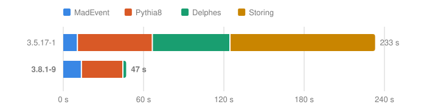

<h1 align="center">
  <br>
  MadGraph
</h1>

<p align="center">
  <a href="https://hub.docker.com/r/startown/madgraph"></a>
  <a href="https://hub.docker.com/r/startown/madgraph/tags"></a>
  <a href="LICENSE"></a>
</p>

[MadGraph5_aMC@NLO](https://github.com/mg5amcnlo/mg5amcnlo) with [Pythia](https://pythia.org) and [Delphes](https://github.com/delphes/delphes).



_Generating 10,000 top-quark pairs with shower and detector simulation on 4 cores._

## Highlights

- Pythia, Delphes, LHAPDF, FastJet, eMELA, and ROOT, ready to use from MadGraph.
- 5x faster: Delphes runs inside each Pythia job, and every stage uses all cores.
- Reproducible: one `iseed` seeds MadEvent, Pythia, and Delphes.
- Built on Docker Hardened Images, with a VEX file that says which reported CVEs affect it.
- Runs natively on `linux/amd64` and `linux/arm64`, including Apple silicon.

## Installation

Pull the image:

```bash
docker pull startown/madgraph:3.8.1-8
```

## Usage

Start MadGraph interactively:

```bash
docker run -it --rm -v "$PWD":/data -w /data startown/madgraph:3.8.1-8 mg5_aMC
```

Or run a script:

```bash
docker run --rm -v "$PWD":/data -w /data startown/madgraph:3.8.1-8 mg5_aMC commands.mg5
```

For example, this `commands.mg5` generates 1,000 top-quark pairs with parton shower and detector simulation. The fixed core count and random seed make it reproducible:

```
set nb_core 4

generate p p > t t~
output pp2tt
launch

shower=Pythia8
detector=Delphes
done

set nevents 1000
set iseed 1
set HEPMCoutput:file hepmc.gz
done
```

The results land in `pp2tt/Events/run_01/`:

| File                            | Contents                           |
| ------------------------------- | ---------------------------------- |
| `run_01_tag_1_banner.txt`       | every card and setting of the run  |
| `unweighted_events.lhe.gz`      | parton-level events                |
| `tag_1_pythia8_events.hepmc.gz` | particle-level events from Pythia  |
| `tag_1_delphes_events.root`     | detector-level events from Delphes |

This image defaults to `HEPMCoutput:file autoremove`, unlike MadGraph's `hepmc.gz`. In MadGraph, this setting deletes the HepMC file at the end of the run; with our patches, it runs Delphes inside each Pythia job instead, so no HepMC is written.

## Security

Scan the image with Docker Scout (needs a Docker login). Our [VEX file](madgraph.vex.json) marks which reported CVEs affect it:

```bash
docker scout cves \
  --vex-location https://raw.githubusercontent.com/startown-ai/madgraph/main/madgraph.vex.json \
  --vex-author '<paxonlee@startown.ai>' \
  startown/madgraph:3.8.1-8
```

## License

This repository is licensed under the [Apache License 2.0](LICENSE), while the packages it builds keep their own licenses:

| Package                                                                                                                                                                                                                                     | Version | License            |
| ------------------------------------------------------------------------------------------------------------------------------------------------------------------------------------------------------------------------------------------- | ------- | ------------------ |
| [FastJet](https://fastjet.fr)                                                                                                                                                                                                               | 3.5.3   | GPL-2.0-or-later   |
| [HepMC](https://hepmc.web.cern.ch/hepmc/)                                                                                                                                                                                                   | 3.3.1   | LGPL-3.0-or-later  |
| [LHAPDF](https://lhapdf.hepforge.org)                                                                                                                                                                                                       | 6.5.6   | GPL-3.0            |
| [ROOT](https://root.cern)<br>+ `eg-no-graphics.patch`                                                                                                                                                                                       | 6.36.14 | LGPL-2.1-or-later  |
| [Delphes](https://github.com/delphes/delphes)<br>+ `no-display.patch`<br>+ `no-graphics.patch`                                                                                                                                              | 3.5.1   | GPL-3.0-or-later   |
| [eMELA](https://github.com/gstagnit/eMELA)                                                                                                                                                                                                  | 1.0.1   | MIT                |
| [Pythia](https://pythia.org)                                                                                                                                                                                                                | 8.317   | GPL-2.0-or-later   |
| `main164delphes`: Pythia's `main164`<br>+ `main164delphes.patch`<br>+ `DelphesPythia8Event.h`                                                                                                                                               | 8.317   | GPL-3.0-or-later   |
| [MadGraph5_aMC@NLO](https://github.com/mg5amcnlo/mg5amcnlo)<br>+ `quiet-warnings.patch`<br>+ `seeds.patch`<br>+ `cores.patch`<br>+ `delphes-stream.patch`<br>+ `fast-lhe-split.patch`<br>+ `hadd-no-j.patch`<br>+ `delphes-inprocess.patch` | 3.8.1   | NCSA-style license |
